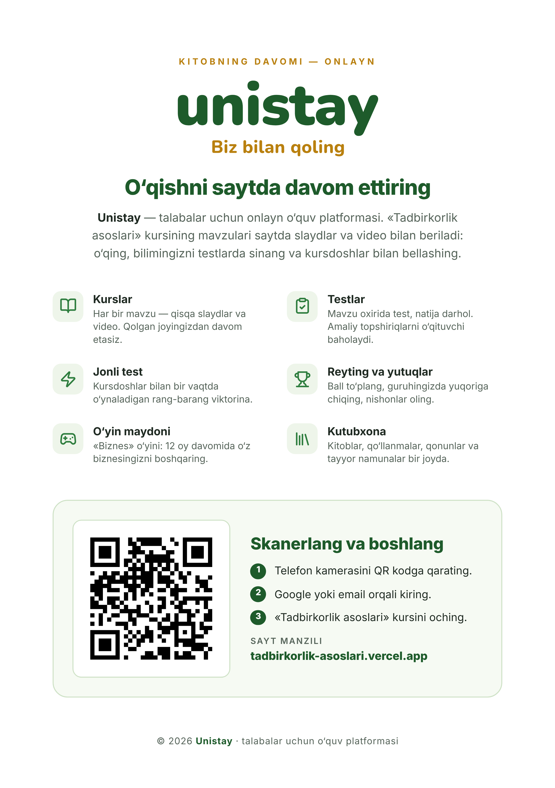

# «Tadbirkorlik asoslari» kitobi — oxirgi sahifa (Unistay)

Kitobning oxirgi sahifasida Unistay logotipi, sayt haqida qisqacha ma'lumot va saytga olib boradigan QR kod bor.

QR kod va sahifadagi manzil: **https://tadbirkorlik-asoslari.vercel.app/**
QR kod skaner qilib tekshirilgan (rangli va oq-qora sahifada, kichraytirilgan rasmda ham o'qiladi).

## Fayllar

| Fayl | Nima uchun |
|---|---|
| `unistay-oxirgi-sahifa-A5-rangli.pdf` | Bosmaxonaga: A5 (148×210 mm), vektor, rangli bosma uchun |
| `unistay-oxirgi-sahifa-A5-oq-qora.pdf` | Bosmaxonaga: kitob ichi oq-qora bosilsa |
| `unistay-oxirgi-sahifa-rangli.png`, `-oq-qora.png` | Word'ga rasm sifatida qo'yish uchun (2476×3512 px — A4 uchun ~300 dpi) |
| `qr-kod.svg`, `qr-kod.png` | Faqat QR kodning o'zi — boshqa joyga qo'yish uchun |

- A4 va A5 o'lchamlarining bo'yi va eni bir xil nisbatda. Shuning uchun PDF'ni A4 yoki boshqa shu nisbatdagi
  formatga sifatini yo'qotmasdan kattalashtirish mumkin.
- Word'da sahifaga qo'yish: Qo'yish → Rasm → PNG faylni tanlang. So'ng rasmni sahifaning chetidan chetigacha cho'zing
  (yoki maydonlarni 0 qiling).
- QR kodni 2 sm dan kichraytirmang.
- Sayt manzili o'zgarsa (masalan, o'z domeni ulansa), QR kodni qayta yasash kerak. Bosmadan oldin QR kodni telefonda
  skaner qilib ko'ring.
