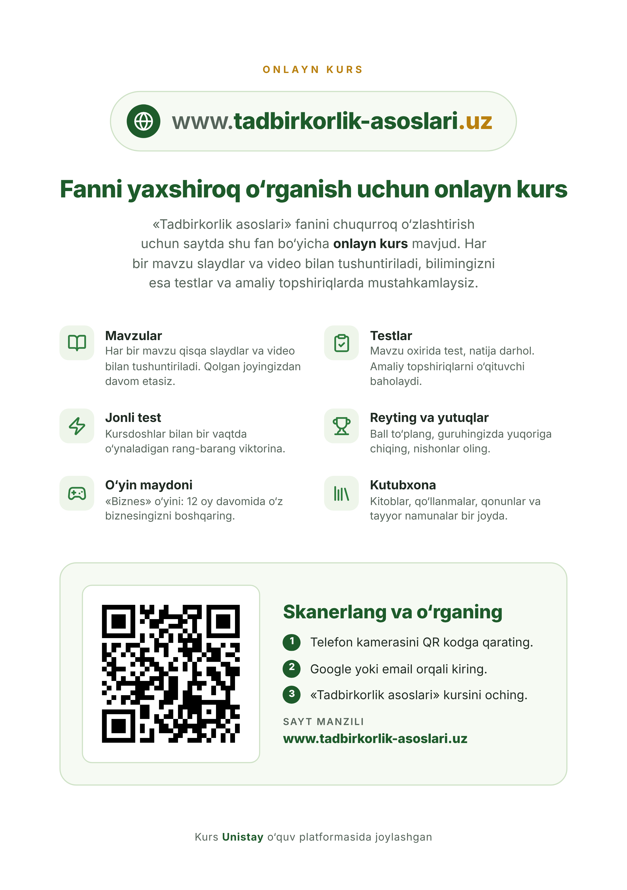

# «Tadbirkorlik asoslari» kitobi — oxirgi sahifa

Kitobning oxirgi sahifasi o'quvchiga «Tadbirkorlik asoslari» fanini yaxshiroq o'rganish uchun onlayn kurs
borligini aytadi. Sahifada sayt manzili, kurs imkoniyatlari va saytga olib boradigan QR kod bor.

QR kod va sahifadagi manzil: **https://www.tadbirkorlik-asoslari.uz/**
QR kod skaner qilib tekshirilgan: rangli va oq-qora sahifada, kichraytirilgan rasmda ham o'qiladi.
Bosmaga berishdan oldin domen saytni ochishini telefonda tekshiring.

## Fayllar

| Fayl | Nima uchun |
|---|---|
| `kitob-oxirgi-sahifa-A5-rangli.pdf` | Bosmaxonaga: A5 (148×210 mm), vektor, rangli bosma uchun |
| `kitob-oxirgi-sahifa-A5-oq-qora.pdf` | Bosmaxonaga: kitob ichi oq-qora bosilsa |
| `kitob-oxirgi-sahifa-rangli.png`, `-oq-qora.png` | Word'ga rasm sifatida qo'yish uchun (2476×3512 px, A4 uchun ~300 dpi) |
| `qr-kod.svg`, `qr-kod.png` | Faqat QR kodning o'zi, boshqa joyga qo'yish uchun |

- A4 va A5 o'lchamlarining bo'yi va eni bir xil nisbatda. Shuning uchun PDF'ni A4 yoki boshqa shu nisbatdagi
  formatga sifatini yo'qotmasdan kattalashtirish mumkin.
- Word'ga qo'yish: Qo'yish → Rasm → PNG faylni tanlang. So'ng rasmni sahifaning chetidan chetigacha cho'zing
  (yoki maydonlarni 0 qiling).
- QR kodni 2 sm dan kichraytirmang.
- Sayt manzili o'zgarsa, QR kodni qayta yasash kerak.
