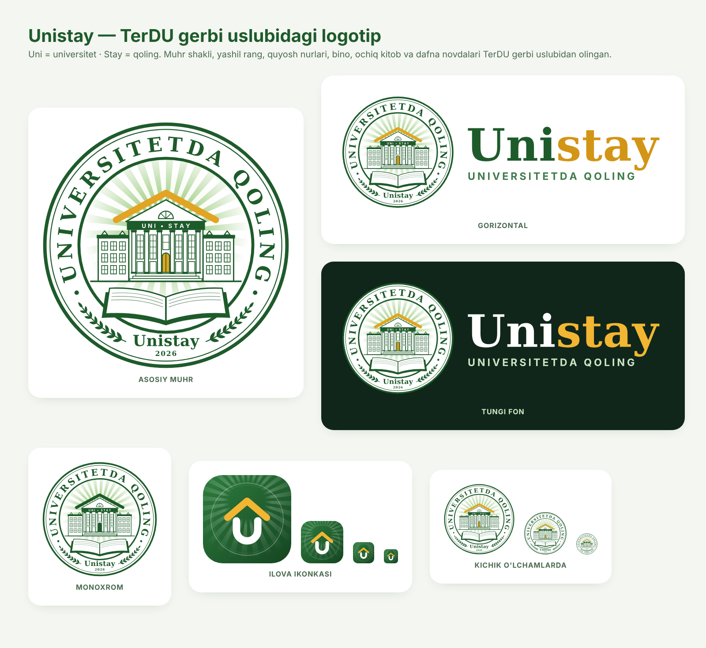

# Unistay — TerDU gerbi uslubidagi logotip

**Uni** — universitet, **Stay** — qoling. Shior: **«Universitetda qoling»**.

## Ramzlar

| Element | Ma'nosi |
|---|---|
| Dumaloq muhr, ikki qavat halqa, yashil rang | TerDU gerbi uslubi — akademik, rasmiy ko'rinish |
| Quyosh nurlari | Bilim, yangi kun, istiqbol |
| Ustunli bino | **Uni** — universitet |
| Oltin rangli uy tomi va yorug' eshik | **Stay** — qolish, «o'z uyingdek» joy |
| Ochiq kitob | O'qish, kurs materiallari |
| Dafna novdalari | Yutuq, ball, g'alaba |
| «Unistay 2026» | Brend nomi va tashkil topgan yil |

Universitetning nomi va gerbi aynan ko'chirilmagan: faqat kompozitsiya va uslub olingan.
Shu sababli logotipni Play Market va boshqa joylarda ishlatsa bo'ladi.

## Fayllar

| Fayl | Qayerda ishlatiladi |
|---|---|
| `unistay-muhr.svg` / `.png` (1024 px) | Asosiy logotip: sertifikat, taqdimot, sayt sarlavhasi, muhr |
| `unistay-muhr-monoxrom.svg` / `.png` | Bir rangli bosma: muhr, shtamp, gravyura |
| `unistay-gorizontal.svg` / `.png` | Oq fondagi sarlavha, banner, blank |
| `unistay-gorizontal-tungi.svg` / `.png` | Qorong'i fon |
| `unistay-ikonka.svg`, `unistay-ikonka-512.png` | Ilova ikonkasi (yumaloq burchakli) |
| `unistay-ikonka-kvadrat.svg`, `unistay-ikonka-play-512.png` | Play Market ikonkasi: to'liq kvadrat, burchaklarni Google o'zi yumaloqlaydi |

Kichik o'lchamda (64 px dan kichik) muhr o'rniga ikonkani ishlating: muhrdagi mayda yozuvlar o'qilmay qoladi.

## Yozuvli logotip: «unistay · Biz bilan qoling» (saytda ishlatiladi)

| Fayl | Qayerda ishlatiladi |
|---|---|
| `unistay-yozuv.svg` / `.png` (2524×1176, shaffof fon) | Oq yoki och fondagi banner, taqdimot, hujjat |
| `unistay-yozuv-tungi.svg` / `.png` | Qorong'i fon (to'q yashil plashka bilan) |
| `studyquest/public/unistay-wordmark.svg`, `unistay-wordmark-dark.svg` | Saytda: yon menyu va yuklanish ekrani (kunduzgi va tungi rejim) |

- «unistay» TerDU gerbining to'q yashil rangida (`#1E5B2B`), tungi rejimda oq rangda.
- Tagida kichik «Biz bilan qoling» shiori, oltin rangda.
- Harflar Nunito Black/ExtraBold shriftida (SIL OFL litsenziyasi, tijoriy foydalanish mumkin).

## Ranglar

| Rang | HEX |
|---|---|
| To'q yashil (asosiy) | `#1E5B2B` |
| Oltin (tom, «stay») | `#E2A422` / matnda `#D39516` |
| Och yashil (nurlar) | `#7DBA5A` |
| Ikonka foni | `#2E7D3E` → `#154521` |

SVG fayllardagi barcha yozuvlar konturga aylantirilgan (DejaVu Serif Bold, Inter Bold), shuning uchun
shrift o'rnatilmagan qurilmada ham bir xil ko'rinadi.
